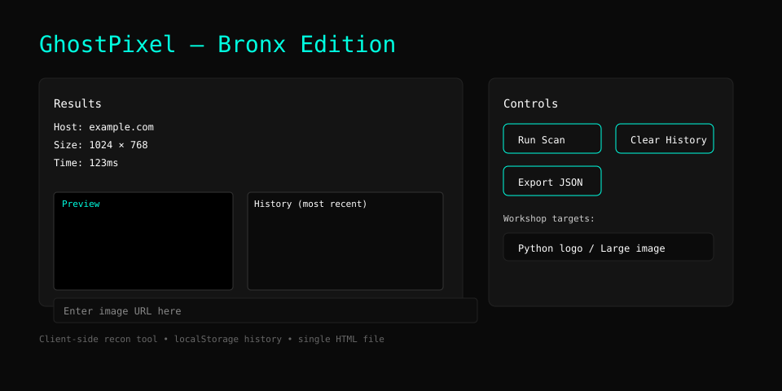

# GhostPixel — Bronx Edition

A tiny browser-based recon/workshop tool that checks whether an image URL loads from the client and reports host, dimensions, and load time. Built as a single HTML page with embedded CSS and JavaScript.

## Demo

## Features
- Enter an image URL and measure whether it loads, its size (width × height), and load time.
- Saves a local history of scans using localStorage (exportable JSON).
- Quick workshop buttons to set example image targets.

## Usage
1. Open `index.html` in your browser (or host it on any static file server).
2. Enter an image URL (for example: `https://example.com/image.png`).
3. Click "Run Scan" — results will show in the Results panel and a preview will appear on success.
4. Use "Clear History" to remove stored scan history or "Export JSON" to download it.

## Implementation notes
- UI is a single HTML file (`index.html`) with inline CSS and JavaScript.
- History is stored under localStorage key `ghostpixel-history`.
- The app uses the `Image()` API and `performance.now()` to measure load times.
- No server-side code — everything runs client-side in the browser.

## Security & Privacy
- This tool performs only client-side requests from the user’s browser.
- Be mindful that loading third-party images may cause the browser to make network requests to remote hosts; do not scan targets you do not have permission to test.

## Development
- Primary language: HTML
- Files: `index.html` (app), `LICENSE` (MIT)

## License
This project is licensed under the MIT License. See `LICENSE` for details.
